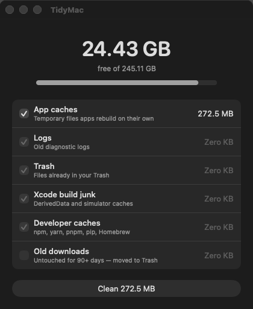

# TidyMac

A tiny, dead-simple Mac app that frees up disk space in one click.

- **Light:** ~280 KB, a single Swift file, zero dependencies.
- **Fast:** scans in parallel, usually a few seconds.
- **Safe:** only removes things that get rebuilt automatically. Never touches your documents, photos or system files.
- **Private:** fully on-device. No network access, no telemetry, no accounts.

<p align="center">
  
</p>

## What it cleans

| Category | What | Default |
|---|---|---|
| App caches | `~/Library/Caches` (except Homebrew/pip, listed below) | on |
| Logs | `~/Library/Logs` | on |
| Trash | `~/.Trash` (**permanent**) | on |
| Xcode build junk | DerivedData, CoreSimulator caches | on |
| Developer caches | Homebrew, pip, npm, yarn, pnpm, Gradle, `~/.cache` | on |
| Old downloads | `~/Downloads` items untouched for 90+ days, **moved to Trash** | off |

## Install

**Requirements:** macOS 13+ and the Xcode Command Line Tools (`xcode-select --install`).

```bash
git clone https://github.com/Dhee2211/TidyMac.git
cd TidyMac
make
open TidyMac.app
```

Optional: `make install` copies it to `/Applications`.

The app is ad-hoc signed, not notarized. On first launch, right-click it → **Open** → **Open**.

## Use

1. Open TidyMac. It scans automatically.
2. Untick anything you want to keep.
3. Click **Clean X GB** and confirm.

### Permissions

macOS protects `~/.Trash` and `~/Downloads`. If those show **0 B** but you know they aren't empty, grant TidyMac **Full Disk Access** in *System Settings → Privacy & Security*, then relaunch.
Emptying the Trash may also prompt you to allow TidyMac to control Finder.

## Develop

```bash
make          # build TidyMac.app
make run      # build and launch
make clean    # remove build output
make screenshot  # regenerate docs/screenshot.png
```

Everything lives in [`TidyMac.swift`](TidyMac.swift):

- `Kind` — the list of cleanup categories (add yours here).
- `size(of:)` — fast allocated-size calculation.
- `Model` — scan and clean logic.
- `ContentView` — the UI.

See [CONTRIBUTING.md](CONTRIBUTING.md) for how to add a category.

## Contribute

Contributions are welcome — from a one-line new cache path to bigger ideas.

- 💡 **Request a feature:** [open a feature request](../../issues/new?template=feature_request.yml)
- 🐛 **Report a bug:** [open a bug report](../../issues/new?template=bug_report.yml)
- 🔧 **Send a PR:** read [CONTRIBUTING.md](CONTRIBUTING.md)

Ideas on the wishlist: large-file finder, menu-bar mode, scheduled cleaning, dry-run list view, localization.

## Safety promise

Anything added to TidyMac must be regenerable or recoverable (moved to Trash). If you're unsure whether something is safe to delete, it doesn't belong in the default-on set.

## License

[MIT](LICENSE)
